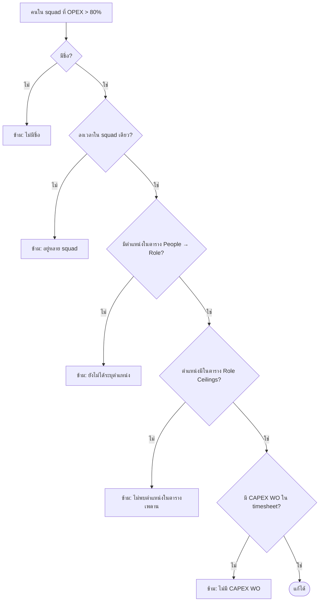
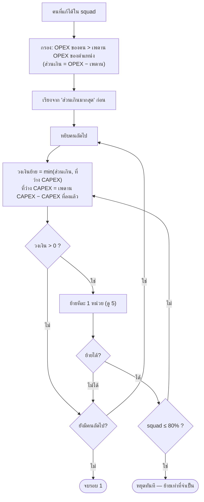
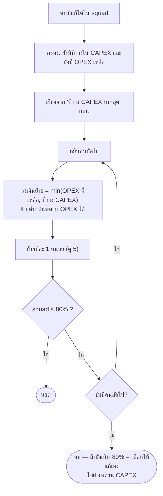
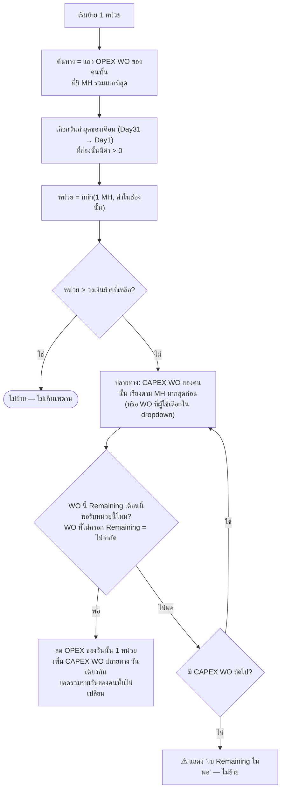

# Flow: ระบบเลือกแก้ Timesheet เมื่อ OPEX เกิน 80%

อัปเดต 2026-10-21: ตรงกับระบบหลังเพิ่ม "ร่างการย้ายที่แก้ได้" (ดู [2026-10-20-editable-rebalance-design.md](2026-10-20-editable-rebalance-design.md)) ข้อ 2–5 คือวิธีที่ระบบสร้างคำแนะนำตั้งต้น ซึ่งไม่เปลี่ยน

ตรงกับโค้ด `planRebalance` ใน `index.html` (เปิดไฟล์นี้ด้วย Markdown preview ที่รองรับ Mermaid เช่น VS Code + Markdown Preview Mermaid Support, หรือวางโค้ดที่ https://mermaid.live)

## 1) ภาพรวม

```mermaid
flowchart TD
    A([กด Run]) --> B{แต่ละ squad<br/>OPEX% > 80% ?<br/>เท่ากับ 80.00% = ผ่าน}
    B -- ไม่ --> OK([ไม่ต้องแก้])
    B -- ใช่ --> C[เลือกคนใน squad ที่แก้ได้<br/>ดู 2) เงื่อนไขคนที่ถูกข้าม]
    C --> R1[รอบที่ 1<br/>คนที่ OPEX เกินเพดานของตำแหน่ง<br/>ดู 3)]
    R1 --> D{squad ≤ 80% แล้ว?}
    D -- ใช่ --> S[แสดงรายการแนะนำ]
    D -- ไม่ --> W1[⚠ เตือน + ปุ่ม 'ทำต่อ']
    W1 -- ผู้ใช้กด --> R2[รอบที่ 2<br/>คนที่ยังมีที่ว่างใน CAPEX<br/>ดู 4)]
    W1 -- ไม่กด --> S
    R2 --> E{squad ≤ 80% แล้ว?}
    E -- ใช่ --> S
    E -- ไม่ --> W2[⚠ เตือนสุดท้าย<br/>แก้ในเพดานไม่ได้ ต้องแก้เอง]
    W2 --> S
    S --> F[ร่างการย้ายแก้ได้ระดับวัน<br/>แก้ วัน / MH / จาก WO / ไป CAPEX WO<br/>ลบหรือเพิ่มแถวได้ + เห็น % 'ถ้า Apply ตามนี้']
    F --> V{ร่างมี error?<br/>เช่น MH เกินที่ลงไว้}
    V -- มี --> F
    V -- ไม่มี --> G{กด Apply?}
    G -- ใช่ --> H[เก็บ timesheet ฉบับเดิม<br/>แก้ grid + คำนวณ Table 1/2 ใหม่<br/>แสดง เดิม → ใหม่ + สรุป CAPEX/OPEX ต่อ squad]
    G -- ไม่ --> NOCH([ไม่มีอะไรเปลี่ยน])
    H --> M[แก้ timesheet ต่อเองได้<br/>ตารางคำนวณใหม่อัตโนมัติ<br/>ประวัติแยก 'Rebalance' กับ 'แก้เอง']
    M --> U[Undo = คืนค่าฉบับเดิมทั้งหมด]
```

## 2) คนที่ระบบ "ไม่แตะ" (ขึ้นคำเตือนพร้อมเหตุผล)



## 3) รอบที่ 1 — เลือก "ใคร" และ "ย้ายเท่าไร"

เพดานจริง (MD) = ค่าในตาราง × วันทำงานเดือนนี้ ÷ 20 (แล้ว × 8 เป็น MH)



## 4) รอบที่ 2 (เมื่อผู้ใช้กด "ทำต่อ")



## 5) การย้าย 1 หน่วย (ระดับวัน และเลือก WO ปลายทาง)



## สรุปหลักการเลือกแก้ (ลำดับความสำคัญ)

| ขั้น | ตัดสินอย่างไร |
|---|---|
| ใครถูกพิจารณา | เฉพาะ squad ที่ OPEX > 80% และคนที่ผ่านเงื่อนไขในข้อ 2 |
| รอบ 1: ลำดับคน | OPEX เกินเพดานตำแหน่งมากสุดก่อน |
| รอบ 1: ย้ายได้สูงสุด | ไม่ต่ำกว่าเพดาน OPEX และไม่เกินเพดาน CAPEX ของตำแหน่ง |
| รอบ 2: ลำดับคน | ที่ว่าง CAPEX มากสุดก่อน (ต้องกด "ทำต่อ") |
| ย้ายอย่างไร | ทีละ 1 MH วันเดียวกัน จาก OPEX WO ที่ลงมากสุด วันท้ายเดือนก่อน |
| ไป WO ไหน | CAPEX WO ที่คนนั้นลงมากสุด ถ้า Remaining ไม่พอ ไป WO ถัดไป (แก้ได้ในร่างก่อน Apply) |
| ผู้ใช้แก้ร่างเอง | ถ้าผิดกติกา (MH ≤ 0, MH เกินที่ลงไว้ในช่องนั้น, จาก/ไป WO เดียวกัน, ไป WO ไม่ใช่ CAPEX) = error กด Apply ไม่ได้ · ถ้าทำให้ CAPEX เกินเพดานหรือ Remaining ติดลบ = เตือนแต่ Apply ได้ |
| หยุดเมื่อไร | squad ≤ 80% ทันที |
| ถ้าแก้ไม่ได้ | เตือนให้แก้เอง ไม่ฝ่ากติกา |

> ค่าเริ่มต้นที่ยังรอยืนยัน (คำถามค้าง): การย้ายทีละ 1 MH วันเดียวกัน, การแก้ได้ทั้ง FTE และ OS, และ Z01-Z03 ที่ยังไม่ถูกใช้ในการคำนวณ
